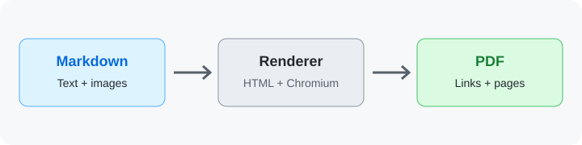

# A sample project report

This document demonstrates Markdown features rendered by the action. The links in the table of contents also work in the PDF.

## Table of contents

- [Overview](#overview)
- [Process](#process)
  - [Figure](#figure)
- [Results](#results)
- [Next steps](#next-steps)

## Overview

This short report shows headings, links, lists, a local image, a table, and a code block. See the [GitHub Actions documentation](https://docs.github.com/en/actions) for more about workflows.

## Process

1. Write a Markdown document.
2. Add images alongside the document.
3. Run the action to create a PDF.

### Figure



*Figure 1. A Markdown document and its assets are rendered into a PDF.*

## Results

| Feature | Example | PDF behavior |
| --- | --- | --- |
| Heading links | [Overview](#overview) | Clickable internal link |
| Figure | Figure 1 | Local image rendered in the document |
| External link | [GitHub Actions](https://docs.github.com/en/actions) | Clickable web link |

## Next steps

Use the action in a workflow to render this example:

```yaml
- uses: dmandache/md-to-pdf@v1.0.0
  with:
    input: example/document.md
    output: example.pdf
```

> Keep local images within the Markdown file's directory so the renderer can load them.
